<h1 align="center">Hola, soy Pablo 👋</h1>
<h3 align="center">Desarrollador Backend & Full Stack · Estudiante de Ingeniería en Sistemas</h3>

  📍 Antigua Guatemala &nbsp;·&nbsp; 🎓 Universidad Mariano Gálvez (8vo. semestre) &nbsp;·&nbsp; 💼 Municipalidad de Antigua Guatemala

---

### 🧑‍💻 Sobre mí

- Construyo **APIs REST** y aplicaciones web completas, desde el modelo de datos hasta la interfaz.
- Trabajo en la **Municipalidad de Antigua Guatemala** desarrollando soluciones internas.
- Me interesa el **backend**, las **bases de datos** y la integración de **IA** en aplicaciones reales.
- Actualmente aprendiendo: _(ej. MongoDB, Docker, AWS)_

### 🛠️ Tecnologías

**Backend:** Node.js · Express · NestJS · FastAPI · Java 
**Frontend:** Vue · Angular · JavaScript · HTML/CSS 
**Bases de datos:** PostgreSQL · Supabase · MySQL 
**Herramientas:** Git · GitHub · Postman · Linux

  

### 🚀 Proyectos destacados

| Proyecto | Descripción | Stack |
|---|---|---|
| [nebajpolis-api](https://github.com/PabloJC182/nebajpolis-api) | API para gestión de cartelera de cines | Node.js · Express |
| [nebajpolis-app](https://github.com/PabloJC182/nebajpolis-app) | Frontend de la cartelera de cines | JavaScript |
| [JogoBonitoCode](https://github.com/PabloJC182/JogoBonitoCode) | Compilador propio con análisis léxico y sintáctico | Java · JFlex · CUP |
| [mapa-app](https://github.com/PabloJC182/mapa-app) | Mapa interactivo de proyectos y parqueos | Angular |
| [gym-api](https://github.com/PabloJC182/gym-api) | API para gestión de gimnasio | Node.js |
| [fast-api-lab](https://github.com/PabloJC182/fast-api-lab) | Laboratorio de APIs con FastAPI | Python |

### 📫 Contacto

- LinkedIn: _(tu enlace)_
- Correo: _(tu correo)_
- Portafolio: _(si tenés)_
